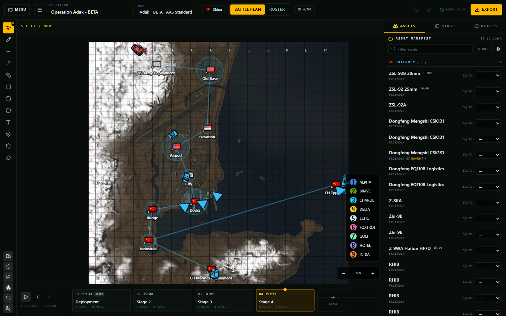
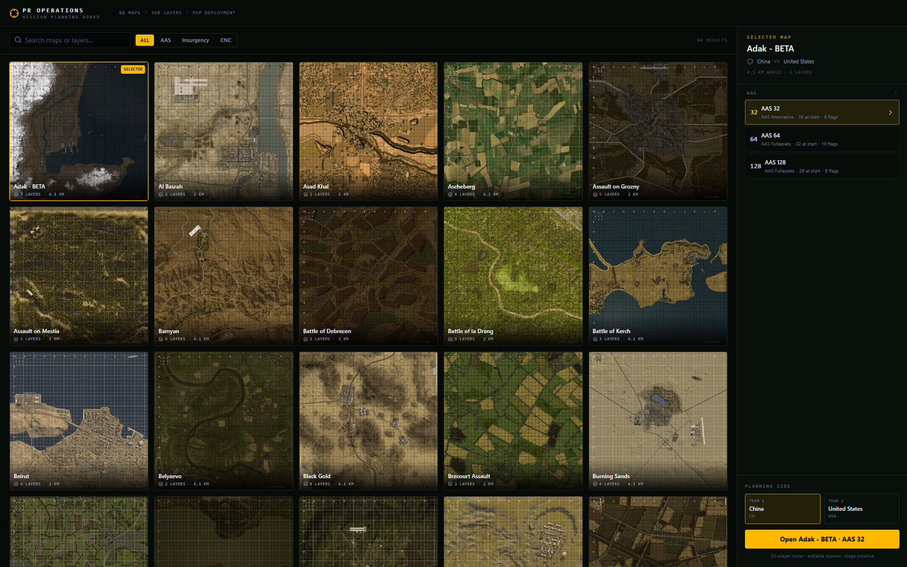
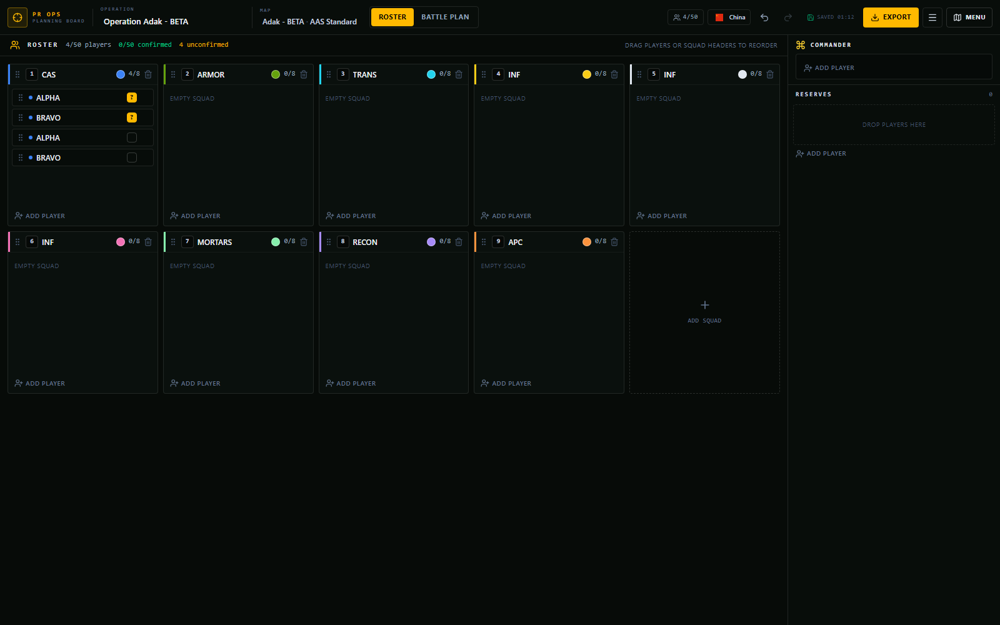

# PR Operations Planner

A browser-based mission planning board for **Project Reality: BF2**. Pick any PvP map and layer, lay out the 50-player roster, place every opening vehicle on its real spawn point, draw the scheme of manoeuvre, build a stage timeline, and export a brief as PowerPoint, PDF or map images.

Static site. No accounts, no backend, no tracking. Plans live in the browser.



## What it does

- **88 maps / 413 PvP layers** extracted from a local PR install: AAS (`gpm_cq`), Insurgency (`gpm_insurgency`) and Skirmish (`gpm_skirmish`). CNC is deliberately excluded.
- **Accurate 2D map art** — the in-game 2048² minimap with its baked A–M / 1–13 grid, not a stretched screenshot. Overlays are mirrored vertically against the texture's axis so flags, vehicles and drawings land on the correct terrain while the grid stays upright.
- **Opening vehicle manifest** — every spawner present at round start, with its team, localised English name, object template, spawn rotation and respawn delay, placed on its real world position. Delayed assets are dimmed with their timer. Icons are PR's own filled white vehicle silhouettes with black backing removed, tinted by team or claiming squad.
- **AASv4 routes** — flags are ordered from each layer's SupplyGroupId (`ABC`: order, alternatives, route). Toggle any number of routes and individual flags, with route-coloured translucent lanes, parallel flags sharing one capture-order number, and real capture radii.
- **Localised flags and ticket data** — English control-point names from `prmaps.utxt`, rectangular in-game capture-point flag sprites matching the neutral flag. Capturable flags show their capture ticket loss; deployment flags are fixed and cannot be switched. Click a capturable flag to cycle owner through neutral and both factions; the same state and control appears in Routes.
- **50-player target roster** — starts with five phonetically named squads (ALPHA–ECHO), fixed ordinal numbers and freeform names; up to ten squads. Drag grip handles to move players or reorder squads, reserve pool, soft 8-player warning (`!`). Each player cycles blank → green `✓` confirmed → amber `?` unconfirmed; blank counts as unconfirmed. Squad badges use PR's own white circular number sprites, tinted with the squad colour.
- **Tactical drawing** — draw, line, arrow (one or both heads, solid or dashed), ruler with distance label, rectangle, ellipse, zone polygon with separate fill opacity, labels, in-game markers and commander-order glyphs, NATO unit symbols.
- **Vehicle trails and squad badges** — vehicles inherit their previous stage position and draw a vehicle-coloured trail from it. Select the vehicle, then click its trail to add a turning point; drag the point to move it, right-click to remove it. Claimed vehicles carry their squad number at the rear. Global and per-vehicle path visibility are available, and return puts the vehicle back at its previous stage position.
- **Stage timeline** — each stage has a mission clock, commander intent and its own drawings plus vehicle moves. A new stage inherits the previous stage's drawings and vehicle positions. Play through the stages during a briefing.
- **Exports** — 16:9 PPTX with title, roster table and one slide per stage; print-ready PDF; ZIP of stage PNGs at 2048 or 3072 px; roster-only PPTX/PDF. PPTX stage notes also go into speaker notes.
- **Autosave + JSON** — the active plan persists in `localStorage`; export/import `.prplan.json` for backups or sharing.

## Quick start

Requirements: Node.js 20+ and pnpm 10/11.

```bash
pnpm install
pnpm dev        # http://127.0.0.1:5173
pnpm build      # production build in dist/
pnpm preview
```

The repository already contains the extracted dataset in `public/data/` (≈60 MB). You do **not** need Project Reality installed to run the site.





## Rebuilding the map data

The extractor reads the local PR installation. Default path:

```
C:\Games\Project Reality BF2\mods\pr
```

Run:

```bash
python tools/extract/extract.py
# or point at another install
set PR_ROOT=D:\Games\Project Reality BF2\mods\pr
python tools/extract/extract.py
```

It writes:

- `public/data/index.json` — map/layer index, factions, counts, image names
- `public/data/layers/<map>__<mode>__<players>.json` — flags, vehicle spawns, factions
- `public/data/maps/*.webp` — downscaled in-game minimaps
- `public/data/thumbs/*.webp` — picker thumbnails
- `public/data/vehicle-templates.txt` — classification report

The extractor uses Pillow. On the bundled DSH runtime:

```powershell
& "$env:DSH_PYTHON" tools/extract/extract.py
```

or just `python` if Pillow is installed.

## Deploy to GitHub Pages

The workflow in `.github/workflows/deploy.yml` builds and publishes `dist/` on every push to `main`.

1. Create a GitHub repository and push this folder.
2. Repository **Settings → Pages → Build and deployment → Source: GitHub Actions**.
3. Push to `main` (or run the workflow manually). The site appears at `https://<user>.github.io/<repo>/`.

`vite.config.ts` uses `base: './'`, so the build works from a project subpath without changes. The dataset is committed, so visitors get every map immediately.

Repository weight: ~58 MB of map data plus normal source and dependencies (dependencies are not committed).

## Using the planner

1. **Pick a map and layer** and choose which side you are planning.
2. **Roster tab** — add players, drag the grip handles between squads, drop a player on the commander slot to promote them. The 50-player count is a target, not a hard cap; the 8-player squad warning appears as `!` beside the counter.
3. **Assets tab** — starts with the round-start filter off and static emplacements visible. Assets are grouped friendly → neutral → enemy. Click an asset to select and rotate it, claim it for a squad, then drag it to a planned position. The vehicle-coloured trail starts at its previous stage position.
4. **Draw** — choose a tool in the left rail. Set colour, width, opacity, dash and (for arrows) both heads. For area tools, toggle "Fill area". Middle-mouse drag pans with any tool.
5. **Routes tab** — toggle routes independently; each visible route has its own colour. Capture-order checkboxes control whether each flag is rendered. Hover or click the flag owner button for ticket loss/bleed and to cycle faction/neutral.
6. **Map layers** — use the visibility icons at the bottom of the left tool rail; hover each for its description. The numbered squad legend sits above the zoom controls; drag a legend badge onto the map to place a squad marker.
7. **Stages** — add stages in the bottom timeline, set the mission clock and notes in the Stage tab. Clicking a stage opens its Stage tab; a new stage inherits the previous stage's drawings and vehicle positions.
8. **Export** — PowerPoint, PDF, stage PNGs, or a roster-only PPTX/PDF.

### Shortcuts

| Key | Action |
| --- | --- |
| `V` | Select / move (drag empty map to pan) |
| Middle drag | Pan with any tool |
| `P` `L` `A` `D` | Draw, line, arrow, ruler |
| `R` `O` `G` | Rectangle, ellipse, zone polygon |
| `T` `M` `U` | Text, marker, unit symbol |
| `E` | Erase |
| Click / drag | Draw lines, arrows and areas either way |
| Wheel | Zoom to cursor (20×) |
| `Ctrl+Z` / `Ctrl+Y` | Undo / redo |
| `Delete` | Remove selection or reset a moved vehicle |
| `Enter` | Finish polygon |
| `Esc` | Cancel drawing / deselect |

## Scope and limitations

- **PvP layers only.** AAS, Insurgency and Skirmish are included; CNC, COOP, gungame and training layers are deliberately excluded. The extractor's `PvP_MODES` map controls this.
- **One planning side.** The roster represents one team; enemy assets are shown as red markers and can be hidden. Switch sides in the Stage tab.
- **Delayed assets** are shown dimmed with their respawn timer. The "Start" filter in Assets shows only what is physically on the map at round start.
- **Map art** comes from Project Reality's own minimap files. It remains the property of the PR team; this is a non-commercial community tool. No game binaries are included.
- **Browser storage** is per-browser. Use *Menu → Export plan JSON* for a durable backup or to move a plan to another machine.
- Exports run entirely client-side; very large plans (many stages at 3072 px) take a few seconds.

## Project layout

```
src/
  components/     editor UI: map canvas, picker, roster, assets, stages, timeline, export dialog
  lib/            projection, canvas renderer, PPTX/PDF/PNG exporters, utilities
  icons.ts        original SVG tactical glyphs
  store.ts        Zustand plan + UI state, undo/redo, autosave
  types.ts        map, plan, roster and drawing schema
tools/extract/    PR data extractor (Python)
public/data/      extracted dataset committed for GitHub Pages
.github/          Pages deployment workflow
```

## Credits

- **Project Reality: BF2** — map imagery, control-point names, vehicle spawn data, vehicle minimap glyphs, flag textures, markers and commander-order icons. Project Reality is the work of its developers and community.
- Interface, NATO unit glyphs, editor and exporters are original to this project.
- Built with React, Konva, PptxGenJS and jsPDF.

Code is MIT licensed; PR-derived assets remain under the Project Reality team's terms.
